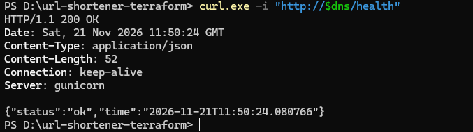
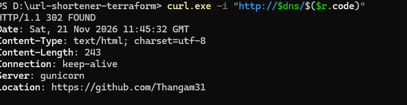
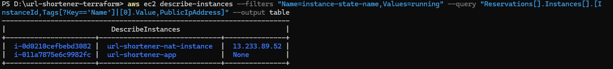

# URL Shortener: Stage 3 (Terraform)

Stage 2 architecture, now fully Infrastructure as Code. One `terraform apply` builds the whole 3-tier environment.

## What it builds

- VPC with public, app (private) and data (private) subnets across 2 AZs
- NAT instance (not NAT Gateway, to stay in free tier) with IP forwarding and iptables MASQUERADE set in user-data
- Application Load Balancer, target group, HTTP listener
- Auto Scaling Group in private subnets with ELB health checks
- IAM role and instance profile for the app instances

## Structure

    main.tf          root module, wires everything
    variables.tf     inputs
    modules/vpc      network + NAT instance
    modules/alb      load balancer
    modules/asg      launch template + Auto Scaling Group

## Run

    $env:AWS_PROFILE = "terraform"
    terraform init
    terraform plan -out=tfplan
    terraform apply tfplan
    terraform destroy

## Proof

## Incidents and fixes

**1. Placeholder user-data.** My first apply returned 200 on /health, but the response came from nginx serving a static file, not my app. I noticed the Server header said nginx instead of gunicorn and the timestamp never changed. Fix: replaced the user-data with Docker install + `docker run -p 80:8080` for the real image.

**2. ASG replacement loop.** After changing the launch template, new instances were killed by the Auto Scaling Group before they finished booting. Docker install and image pull took longer than the 120 second health check grace period. Fix: raised `health_check_grace_period` to 300 seconds.

**3. Lessons from Stage 2 now in code.** The NAT instance missing an iptables MASQUERADE rule broke all private subnet egress in Stage 2. The fix (ip_forward, MASQUERADE, persisted rules) is now in the NAT user-data, so it cannot be forgotten on a fresh deploy.

## Known limitations

- Links are stored in memory per gunicorn worker, so a redirect can return 404 when it hits a different worker, and links are lost when an instance is replaced. Planned fix: DynamoDB data tier.
- Single NAT instance is a single point of failure (cost tradeoff).
- HTTP only, no TLS yet.
- Terraform state is local. Remote state (S3 + DynamoDB lock) is a next step.

## Cost control

Free-tier friendly. Run `terraform destroy` at the end of every session.
